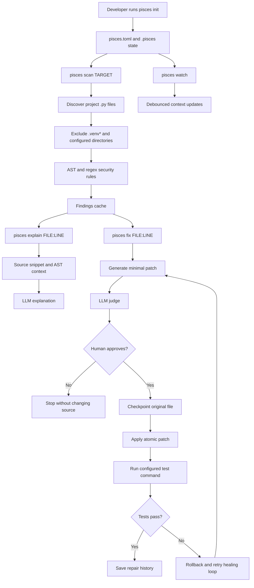

<p align="center">
  
</p>

<h1 align="center">PISCES</h1>

<p align="center">
  <b>AI-Assisted · Self-Healing · Human-Governed Python Security Remediation Patcher</b>
</p>

<p align="center">
  <a href="https://pypi.org/project/pisces-cli/">
    
  </a>
  <a href="https://pypi.org/project/pisces-cli/">
    
  </a>
  <a href="https://github.com/richochetclementine1315/pisces/actions/workflows/ci.yml">
    
  </a>
  <a href="https://github.com/richochetclementine1315/pisces/blob/main/LICENSE">
    
  </a>
  <a href="https://github.com/richochetclementine1315/pisces/blob/main/pyproject.toml">
    
  </a>
  
  
</p>

<p align="center">
  <a href="#-what-is-pisces">What is Pisces?</a> •
  <a href="#-how-it-works">How it Works</a> •
  <a href="#-installation">Installation</a> •
  <a href="#-quick-start">Quick Start</a> •
  <a href="#-commands">Commands</a> •
  <a href="#-configuration">Configuration</a> •
  <a href="#-supported-providers">LLM Providers</a> •
  <a href="#-security-rules">Security Rules</a> •
  <a href="#-contributing">Contributing</a>
</p>

---

## 🐟 What is Pisces?

**Pisces** is an AI-powered, self-healing security CLI for Python codebases. It doesn't just *find* vulnerabilities — it *fixes* them, validates the fix against your test suite, and rolls back automatically if anything breaks.

At its core, Pisces is a **three-stage pipeline**:

| Stage | What happens |
|---|---|
| 🔍 **Detect** | 7 built-in AST + regex security rules scan your code |
| 🤖 **Remediate** | An LLM generates a minimal, targeted patch |
| ✅ **Validate** | Your own test suite verifies the fix works |

The entire process is governed by a **Human-in-the-Loop (HITL)** approval gate — Pisces asks *you* before touching any source file.

---

## ⚙️ How it Works

```
┌──────────────┐     ┌──────────────┐     ┌──────────────┐     ┌──────────────┐
│  pisces scan │ ──▶ │pisces explain│ ──▶ │  pisces fix  │ ──▶ │pisces history│
│              │     │              │     │              │     │              │
│ Runs 7 rules │     │ LLM analyses │     │ LLM patches  │     │ Audit trail  │
│ on .py files │     │ the finding  │     │ Judge reviews│     │ of all fixes │
│              │     │ with full    │     │ You approve  │     │              │
│ Caches to    │     │ attack       │     │ Tests run    │     │ Full diff    │
│ .pisces/cache│     │ scenario     │     │ Rollback if  │     │ Judge scores │
└──────────────┘     └──────────────┘     │ tests fail   │     └──────────────┘
                                          └──────────────┘
```

### The Repair State Machine

```
DETECTED ──▶ PROPOSED ──▶ JUDGED ──▶ AWAITING_APPROVAL
                                            │
                              ┌─────────────┴──────────────┐
                              ▼                            ▼
                           APPROVED                    REJECTED ✗
                              │
                        CHECKPOINTED
                              │
                           APPLIED
                              │
                         VALIDATING
                         ┌────┴────┐
                         ▼         ▼
                     SUCCEEDED  FAILED ──▶ HEALING ──▶ PROPOSED (retry)
                         ✓                                │
                                                    ROLLED_BACK ✗
                                               (all attempts exhausted)
```

### Atomicity Guarantee

Pisces **never writes directly to your source file**. Every patch goes through:

1. 📋 **Checkpoint** — `original.py` saved to `.pisces/history/<id>/`
2. ✏️ **Write** — patch written to `file.py.tmp`
3. 🔄 **Rename** — `.tmp → file.py` (atomic on all OSes)
4. ↩️ **Rollback** — on any failure, `original.py` is restored

### Architecture and Workflow



The deterministic scanner does not call an LLM. LLMs are used only for
explanations, patch generation, and optional patch judging. API credentials
are read from environment variables and are never stored in `pisces.toml`.

---

## 🚀 Installation

### From PyPI (recommended)

```bash
pip install pisces-cli
```

### From Source

```bash
git clone https://github.com/richochetclementine1315/pisces.git
cd pisces
pip install -e ".[dev]"
```

### Requirements

- **Python** ≥ 3.10
- An API key for your chosen LLM provider (see [Supported Providers](#-supported-providers))

---

## ⚡ Quick Start

```bash
# 1. Initialize Pisces in your project
pisces init

# 2. Set your LLM provider API key (example: Groq)
export GROQ_API_KEY=your_key_here

# 3. Configure provider & model
pisces config

# 4. Scan for vulnerabilities
pisces scan .

# 5. Get an AI explanation of a finding
pisces explain auth.py:42

# 6. Apply a self-healing patch (with HITL approval)
pisces fix auth.py:42

# 7. Review your repair history
pisces history
```

---

## 📟 Commands

### `pisces init` — Initialize Project

```bash
pisces init [PATH] [--force / -f]
```

Creates `pisces.toml`, `.pisces/` state directory, and updates `.gitignore`.

| Option | Short | Default | Description |
|---|---|---|---|
| `PATH` | | `.` | Project root to initialize |
| `--force` | `-f` | `False` | Overwrite existing `pisces.toml` |

---

### `pisces config` — Configuration Wizard

```bash
pisces config [PATH] [--show / -s]
```

Interactive wizard that configures provider, model, HITL, and test command.

| Option | Short | Default | Description |
|---|---|---|---|
| `PATH` | | `.` | Project root |
| `--show` | `-s` | `False` | Print current config table and exit |

---

### `pisces scan` — Security Scanner

```bash
pisces scan [TARGET] [--output FILE] [--min-severity LEVEL]
```

Scans Python files with 7 built-in security rules. Caches results for `explain` and `fix`.

| Option | Short | Default | Description |
|---|---|---|---|
| `TARGET` | | `.` | Directory or `.py` file |
| `--output FILE` | `-o` | `None` | Save findings as JSON |
| `--min-severity` | `-s` | `LOW` | `CRITICAL` / `HIGH` / `MEDIUM` / `LOW` / `INFO` |

**Exit code:** `1` if findings exist at/above threshold, `0` if clean — ideal for CI.

---

### `pisces explain` — AI Vulnerability Analysis

```bash
pisces explain <file:line>
```

Sends the finding + ±20 lines of source + AST context to the LLM. Renders a **6-section structured report**:

| Section | Content |
|---|---|
| 📋 Executive Summary | One-line verdict |
| 🔍 Vulnerability Explained | Technical deep-dive |
| ⚔️ Attack Scenario | Step-by-step exploitation |
| 🎯 Root Cause | Exact line + mistake |
| 🛠️ Recommended Fix | Corrected code with comments |
| 📚 References | CWE, OWASP, CVE links |

---

### `pisces fix` — Self-Healing Repair

```bash
pisces fix <file:line> [OPTIONS]
```

The full repair pipeline: generate → judge → approve → patch → test → heal.

| Option | Short | Default | Description |
|---|---|---|---|
| `--dry-run` | | `False` | Show patch without modifying files |
| `--no-judge` | | `False` | Skip adversarial LLM judge |
| `--max-attempts N` | `-m` | from config | Max self-healing retries |

---

### `pisces watch` — Live Context Watcher

```bash
pisces watch [PATH]
```

Watches `.py` files with 0.8s debouncing. Auto-updates `context.json` on every save. Press `Ctrl+C` to stop.

---

### `pisces history` — Repair Audit Log

```bash
pisces history [PATH] [--detail ID] [--limit N]
```

| Option | Short | Default | Description |
|---|---|---|---|
| `--detail REPAIR_ID` | `-d` | `None` | Full detail + diff for one repair |
| `--limit N` | `-n` | `20` | Records to show in list view |

---

## 🔧 Configuration

**`pisces.toml`** (project root — never put API keys here):

```toml
[llm]
provider = "groq"                      # openai | anthropic | gemini | groq | ollama | lmstudio
model    = "llama-3.3-70b-versatile"   # any model your provider supports

[repair]
max_attempts     = 3      # self-healing retry limit
require_approval = true   # HITL — always ask before patching

[validation]
test_command = "pytest"   # command to validate patches

[scan]
exclude = [".git", ".venv", "__pycache__", "node_modules", ".pisces", "dist", "build"]
```

---

## 🤖 Supported Providers

| Provider | Env Var | Default Model |
|---|---|---|
| `openai` | `OPENAI_API_KEY` | `gpt-4o-mini` |
| `anthropic` | `ANTHROPIC_API_KEY` | `claude-3-5-haiku-20241022` |
| `gemini` | `GOOGLE_API_KEY` or `GEMINI_API_KEY` | `gemini-2.0-flash` |
| `groq` | `GROQ_API_KEY` | `llama-3.3-70b-versatile` |
| `ollama` | *(none — local)* | `llama3.2` |
| `lmstudio` | *(none — local)* | `local-model` |

---

## 🛡️ Security Rules

| Rule | ID | Severity | What it Detects |
|---|---|---|---|
| Hardcoded Secret | `S001` | HIGH | API keys, passwords, tokens in source code |
| Command Injection | `S002` | CRITICAL | `subprocess` with f-strings/vars + `shell=True` |
| Unsafe Subprocess | `S003` | HIGH | `shell=True` even with static strings |
| Unsafe Deserialization | `S004` | HIGH | `pickle.load`, `yaml.load` without `SafeLoader` |
| TLS Verify Disabled | `S005` | HIGH | `requests.get(..., verify=False)` |
| Code Injection | `S006` | CRITICAL | `eval(var)`, `exec(var)` with user input |
| Dangerous Filesystem | `S007` | MEDIUM | `shutil.rmtree(variable_path)` |

---

## 🗂️ Project Layout

```
Pisces/
├── pisces/
│   ├── cli.py            # Typer CLI entrypoint — all commands
│   ├── models.py         # Shared dataclasses (Finding, JudgeResult, RepairState…)
│   ├── scanner.py        # 7 security rules (AST + regex)
│   ├── scan_cmd.py       # `pisces scan` implementation
│   ├── explain_cmd.py    # `pisces explain` implementation
│   ├── fix_cmd.py        # `pisces fix` state machine
│   ├── patch_engine.py   # Atomic patch apply, checkpoint, rollback
│   ├── judge.py          # Adversarial LLM judge
│   ├── history_cmd.py    # `pisces history` implementation
│   ├── watcher.py        # `pisces watch` — watchdog integration
│   ├── config_cmd.py     # `pisces config` wizard
│   ├── config_manager.py # pisces.toml loader/writer
│   ├── context_manager.py# context.json AST index
│   ├── llm_client.py     # Multi-provider LLM client
│   ├── ast_visitor.py    # AST walker for file intelligence
│   └── tui.py            # Rich TUI primitives
├── tests/
│   ├── conftest.py
│   ├── test_scanner.py
│   ├── test_patch_engine.py
│   ├── test_models.py
│   ├── test_config_manager.py
│   └── test_context_manager.py
├── pyproject.toml
├── pisces.toml
└── README.md
```

---

## 🤝 Contributing

Contributions are welcome! Please open an issue before submitting a PR.

```bash
git clone https://github.com/richochetclementine1315/pisces.git
cd pisces
pip install -e ".[dev]"
pytest tests/ -v
ruff check pisces/ tests/
```

---

## 📄 License

MIT © [Mrinmoy Matilal](https://github.com/richochetclementine1315)

---


